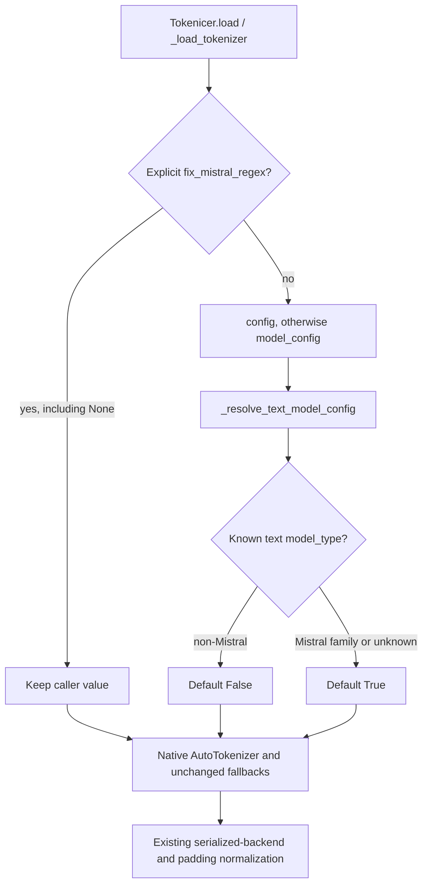

# Config-selected Mistral regex correction

Tokenicer 0.0.18 keeps the selected text configuration authoritative when
choosing the default `fix_mistral_regex` argument. Transformers still decides
whether a Mistral repair applies; Tokenicer does not rewrite regexes itself.

Original MiniCPM checkpoints have 122,753-token SentencePiece-style BPEs and
old config JSON that omits `model_type`. Transformers' local-file detector
therefore cannot exclude them from its Mistral compatibility path. Previously,
Tokenicer unconditionally requested that repair, even when a caller supplied a
resolved non-Mistral config. The resulting ByteLevel pre-tokenizer corrupts
Latin/CJK tokenization before any model executes.



| Input | Before | After |
| --- | --- | --- |
| Selected MiniCPM/Llama config, old JSON without type | Mistral repair requested | Repair disabled by default |
| Selected Mistral/Ministral/Mixtral/Voxtral/Pixtral family or Laguna config | Repair requested | Unchanged |
| No selected type | Transformers detector decides with repair enabled | Unchanged |
| Explicit `fix_mistral_regex=False/True/None` | Caller value | Unchanged |
| Native retry/fallback | Same kwargs as first load | Same selected default/override |

`config` takes precedence over `model_config` for this choice because it is the
exact object supplied to AutoTokenizer. Composite configurations use the
existing text-config resolver. This change does not auto-import any checkpoint
configuration or tokenizer Python and does not change the trust policy.

## Evidence and scope

The pinned `openbmb/MiniCPM-2B-128k` revision
`6011acb51acf3e8c0cb10c428d7064dc39431720` and DPO revision
`9d6de77274c9f364037bf8506b4a831d3520ae79` both encode
`Hello GPT-QModel! 你好，世界。` as:

```text
[21045, 1527, 7809, 63, 95544, 3709, 73, 95320, 23523, 65, 2925, 66]
```

The released 0.0.17 path produces 27 IDs for the same 128k assets. Tests compare
raw serialized and native tokenizer IDs with Tokenicer, including Unicode,
chat rendering, save/reload, corrupt-metadata repair/retry, explicit overrides,
fallback kwargs and real native Mistral digit-splitting behavior. A synthetic
100,001-token BPE reproduces the issue offline. Public pinned tests download
only tokenizer/config assets, not trained model weights.

For package-owned downstream configurations, continue passing the resolved
configuration as both `config=` and `model_config=`. This preserves native
AutoTokenizer selection and avoids independent checkpoint AutoConfig discovery.
No model-name special case, environment switch, or downstream tokenizer shim
is required.
