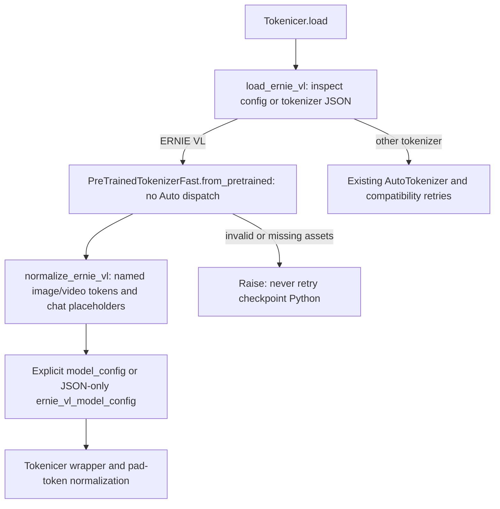

# ERNIE VL tokenizer loading

Legacy ERNIE VL checkpoints name `Ernie4_5_VLTokenizer` in JSON and advertise
checkpoint Python through `auto_map`. Their SentencePiece/BPE assets are
loadable by Transformers 5's native `PreTrainedTokenizerFast`.

| Mechanism | Before | After |
|---|---|---|
| Tokenizer selection | `Tokenicer._load_tokenizer` used AutoTokenizer, then dynamic-class/trust retries | Recognized ERNIE VL metadata selects the native backend before Auto dispatch |
| Config retrieval | `Tokenicer.load` called `auto_config` when no explicit config was supplied | The native ERNIE path reads config JSON only |
| Image placeholder | Legacy chat template emits `<\|image@placeholder\|>` | Emits the existing `<\|IMAGE_PLACEHOLDER\|>` token |
| Video placeholder | Legacy processor reused the image patch token | Native processor uses a separate `<\|VIDEO_PLACEHOLDER\|>` token |

Pinned source: [baidu/ERNIE-4.5-VL-28B-A3B-PT,
e3815e65c607ea211bfe21b46ab0cd264b76731c](https://huggingface.co/baidu/ERNIE-4.5-VL-28B-A3B-PT/tree/e3815e65c607ea211bfe21b46ab0cd264b76731c)
(Apache-2.0). No checkpoint Python is copied or imported. Public metadata
tests download only five tokenizer assets, never weights.

The public bundle retains image ID `100295` and adds video ID `103367`, matching
the native ERNIE config's reserved vocabulary slot. Plain text IDs for
`Hello world!  中文\nX` remain `[16276, 3135, 94018, 269, 11422, 23, 94026]`.
Explicit named special-token and padding overrides survive save/reload.

`tests/test_ernie_vl.py` proves hostile tokenizer/config auto-maps are not run,
both with trust disabled and enabled; malformed native assets propagate an
error rather than entering the legacy remote-code retry. The initial three
regressions failed on the old implementation (including a marker written by
the hostile module); they pass with native selection.

GPT-QModel consumes the correction through `Tokenicer.load`, with the selected
native model config supplied explicitly. No trained-weight evaluation or
quantization-quality claim is made here. Local `/monster/data/model` smoke
fixtures remain optional and are explicitly skipped when unavailable.
