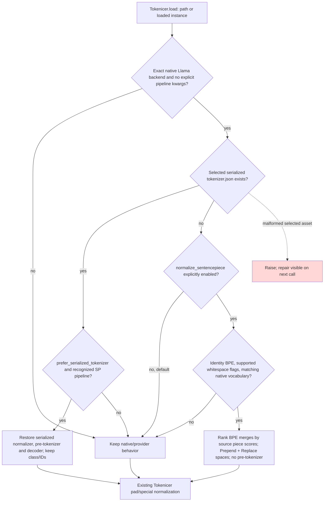

# Historical SentencePiece conversion

`Tokenicer.load(..., normalize_sentencepiece=True)` explicitly requests the
historical source-fast conversion for **exact native `LlamaTokenizer`**, identity
SentencePiece BPE bundles without a serialized tokenizer. The default is
**False**: the original converter version cannot be recovered from an identity
SentencePiece model alone, and modern native conversion may be intentional.
Class selection and remote-code policy remain unchanged.

```python
tokenizer = Tokenicer.load(
    native_llama_instance,           # a path is also supported
    model_config=selected_config,
    normalize_sentencepiece=True,    # only for independently qualified sources
)
```

This option is consumed by `Tokenicer.load`, not sent to native constructors or
`prepare_load_kwargs`. Package-owned subclasses, other native providers,
non-identity normalizers, non-BPE models and mismatched vocabularies are untouched.
Mistral regex repair remains a separate selected-config policy.

## Flow and ownership



| Boundary | Before | After |
| --- | --- | --- |
| SP-only native Llama, default | Native TF5 conversion | Unchanged |
| Explicit historical profile | Native Metaspace and ID-ranked merges can differ from source fast | Score-ranked merges and historical unconditional prefix |
| Native Llama saved as JSON | Reload can replace the saved pipeline | Restore the selected SP pipeline without changing class |
| Explicit caller pipeline controls | Native behavior | Still native, even with the historical option enabled |
| Selected subfolder | Legacy-class probe could inspect root decoys | Declared-class probe uses the same selection kwargs |
| Package-owned tokenizer | Provider owns behavior | Unchanged, including native subclasses |

An existing serialized SP pipeline is authoritative independently of the
historical conversion option. `normalize_sentencepiece=False` disables SP-only
conversion, **not** serialized preservation; use
`prefer_serialized_tokenizer=False` to retain the native serialized-load behavior.
Explicit `legacy` and `add_prefix_space` keys, including `None` and `False`, or
explicit tokenizer/pipeline kwargs bypass both corrections. No source-specific
BOS/EOS semantics or added-token IDs are inferred.

For loaded instances, a resolved SP file or local asset directory identifies the
source. A remote JSON-only instance without a matching revision selector is left
unchanged rather than guessing its original Hub revision; load from its local
asset directory or pass the matching `revision`. Path loads retain their selected
revision/subfolder/cache/auth arguments. No checkpoint Python, AutoConfig
discovery, asset writes or custom metadata memoization is introduced.

## Independent references and regressions

The reference fixture stores eight literal source-fast corpus cases per bundle,
all authoritative added-token metadata, source normalizer fields and eight
asset SHA256 hashes. The source-fast IDs were captured independently using
Transformers **4.37.2 `LlamaTokenizerFast`**, not the new converter or raw slow
SentencePiece output:

| Data source | Pinned revision |
| --- | --- |
| `OpenGVLab/InternVL-Chat-V1-2` | `60f4206a208ef1eedb1566e4a3039450a283703b` |
| `OpenGVLab/InternVL2-4B` | `6eb21ec278fbdb03b751a3d48d8dfc9724e05608` |

Only tokenizer data files are downloaded. These identity BPE bundles have no
`tokenizer.json`; their `add_dummy_prefix` values differ. The historical fast
converter nevertheless prepended `▁` unconditionally and ranked merges by piece
scores. TF5 Metaspace does not insert that prefix before existing spaces, and
ID-ranked merges change some Phi3-wrapper words. For
`"  spaces\n中文 café 🐍 123"`, source IDs start `[140, 59575, ...]` and
`[1, 259, 8162, ...]`; native TF5 starts `[141, 59575, ...]` and
`[1, 259, 22854, ...]` respectively.

Historical fast conversion also misassigned some added IDs, so those IDs are
**not** copied. The original metadata remains authoritative: e.g. V1-2's
`<IMG_CONTEXT>` stays `64000`, not the old converter's `64002`. Both providers
remain exact native Llama, and native saving records
`tokenizer_class: LlamaTokenizer`. Two native JSON save/reload cycles retain the
pipeline and every qualified text/special-token case, without persisting or
requiring the SP opt-in again.

Qualification covers path/loaded instance, trust `None`/False/True, exact IDs and
added flags, source-byte immutability, one normalization call, no constructor
option leakage, default-off and explicit controls, owned providers, unsupported
normalizers, selected subfolders/root decoys, malformed assets and repaired-path
retries. Disabling the correction produced twelve intended source-ID failures;
the independent downstream owner also observed six historical-vector failures
and ten controls before the correction.

```bash
PYTHON_GIL=0 python -m pytest tests/test_sentencepiece.py -q
PYTHON_GIL=0 python -m pytest tests -q -rs
```

Python 3.14.6t / `PYTHON_GIL=0`, Transformers 5.23.0, CPU Torch 2.15.0,
Tokenizers 0.23.3 and SentencePiece 0.2.3: **38 SP tests passed** in 40.79 seconds;
the full Tokenicer suite was **178 passed, 28 skipped** in 64.14 seconds. Skips
are 27 unavailable local tokenizer fixtures and one pre-existing serialized
fixture that no longer differs on this Transformers version. Changed-path
Ruff 0.14.2, compileall and `git diff --check` pass. Full-repository Ruff has
three pre-existing findings in unchanged files (two import-order and one
module-import-order finding); those files are not changed here.

No trained-weight quality, GPU or concurrent execution qualification is claimed.
This remains part of the unreleased 0.0.19 source candidate in
[PR #66](https://github.com/ModelCloud/Tokenicer/pull/66).
