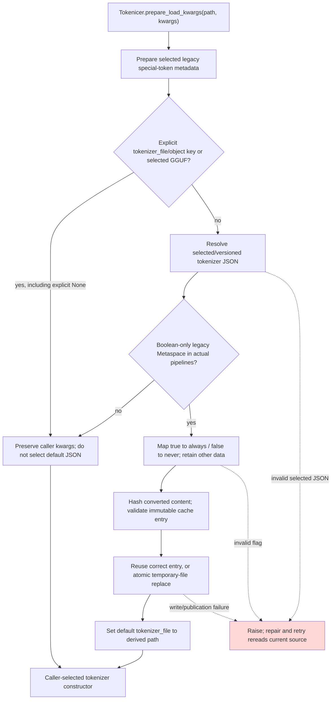
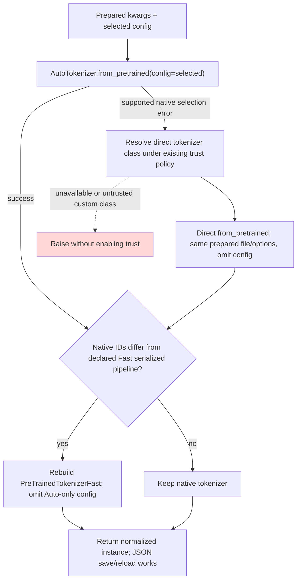

# Legacy serialized Metaspace before construction

Version **0.0.20 candidate, not released**. No checkpoint Python, model-name
heuristic, environment behavior switch, or GPT-QModel normalization shim is used.

## Contract

`Tokenicer.prepare_load_kwargs(path, **kwargs)` now also reads the selected
serialized tokenizer JSON. A genuine `Metaspace` node in `pre_tokenizer` or
`decoder`, including nested `Sequence` nodes, is converted only when it declares
legacy boolean `add_prefix_space` and omits modern `prepend_scheme`:

| Serialized state | Preparation |
| --- | --- |
| `add_prefix_space: false`, no scheme | `prepend_scheme: "never"` |
| `add_prefix_space: true`, no scheme | `prepend_scheme: "always"` |
| Explicit `prepend_scheme`, including `"first"` | Unchanged; native parser owns conflicts |
| Both fields absent; ByteLevel or other pipeline | Unchanged; no inference |
| Non-boolean legacy flag without scheme | Contextual `ValueError`, no cache publication |

Converted nodes omit the obsolete boolean. All other JSON data, including
vocabulary, merges, special-token IDs/flags, replacement, split behavior,
normalizer, and post-processor, is preserved. Class selection and trust policy
remain with the caller. No tokenizer is constructed by preparation.

Explicit caller `tokenizer_file` or `tokenizer_object` keys, **including `None`**,
remain authoritative: preparation does not read/replace the default tokenizer
JSON in those cases. A caller-selected legacy file may therefore still fail its
native parser; callers wanting default compatibility should omit those keys.
Explicit GGUF selection likewise bypasses serialized-file preparation. Other
caller kwargs, including falsey values, are preserved.

## Source selection and cache lifetime

The selected `revision`, `subfolder`, auth token, `cache_dir`, offline mode,
force-download, proxies, and repository type reach the file resolver. Versioned
`fast_tokenizer_files` use Transformers' own filename selector. Root and unused
JSON decoys do not replace selected files.



Derived files live under `<cache_dir or HF_HUB_CACHE>/tokenicer/metaspace-v1/`.
The filename is the SHA256 of complete converted bytes. Each call rereads current
source bytes; no path-keyed metadata memoization hides a repaired or replaced
source. Cached content is checked before reuse and atomically repaired if corrupt.
Temporary files are removed after publication failure; retry is ordinary fresh
preparation. Concurrent preparation can publish only complete identical content.
Old content-addressed files remain usable by already-issued kwargs and loaded
instances. The cache is not deleted while constructors may still consume it.
Source checkpoint assets, including read-only local directories and Hub cache
blobs, are never rewritten. A writable derived-cache directory is required only
when conversion is actually necessary; cache I/O failures propagate.

## Constructor-only config ownership

`config` remains authoritative at `AutoTokenizer.from_pretrained` for native
class selection. Once a tokenizer class has already been selected, Tokenicer's
direct constructor retries and serialized-backend rebuild omit that Auto-only
argument. It must not become tokenizer `init_kwargs` and later fail JSON save.
The caller's config object is not mutated or removed from public preparation.



| Old mechanism | Replacement |
| --- | --- |
| `Tokenicer.prepare_load_kwargs` only prepared special-token metadata | Also prepares legacy serialized Metaspace before the native constructor |
| Rust parser rejected missing scheme + legacy false | Explicit `never`, matching tokenizers 0.15.2 |
| `Tokenicer._serialized_tokenizer_file` local root-only probe | Same selected/versioned file resolver and prepared override as construction |
| `_resolve_serialized_tokenizer` and direct retries forwarded Auto-only config | Config remains at Auto selection; excluded from selected direct constructors |
| Native tokenizer retained an unserializable model config | Two JSON save/reload cycles retain IDs without storing model config |

## Independent release evidence

`tests/fixtures/legacy_metaspace_reference.json` records exact source revisions,
all three asset SHA256 hashes, and independently computed IDs/decodes for:

| Bundle | Revision | Pipeline |
| --- | --- | --- |
| `xverse/XVERSE-7B-Chat` | `60acc8c453c067b54df88be98bfdf60585ab5441` | Legacy Metaspace + Digits/Punctuation; Metaspace + ByteFallback decoder |
| `xverse/XVERSE-MoE-A4.2B` | `3dc97ca598fd5b8325589eee134ff1bb620bddda` | Identical tokenizer JSON hash, distinct pinned bundle |
| `xverse/XVERSE-Ent-A5.7B` | `bb9f23cc7fe2afdfb721be31875c39d11f8a18ef` | Unchanged ByteLevel control |

The shared Metaspace tokenizer SHA256 is
`588e468eb27f757265fe6a057ea858fdeb20b86ac4d5f143bae54d68f73849ac`.
The ByteLevel control hash is
`79e3e522635f3171300913bb421464a87de6222182a0570b9b2ccba2a964b2b4`.

The raw unmodified JSON and `PreTrainedTokenizerFast` were independently rerun
under Python 3.11.18 / tokenizers 0.15.2 / Transformers 4.38.2. All 15 source
text/ID/decode vectors agreed, including CJK, repeated whitespace, tab/newline,
combining Unicode, NUL, emoji, and special-looking strings. Current tokenizers
0.23.3 rejected both raw legacy bundles but accepted ByteLevel unchanged.
The new public regression was red **6 failed / 4 passed** before the fix,
all failures at the intended Metaspace parser boundary.

For example, `Hello world!` must encode as `[75, 96760, 114, 97895, 36]` for
both legacy bundles, not a rebuilt tokenizer's approximation.

The config leak was separately reproduced from only pinned
`baidu/Unlimited-OCR@8249d20b2822a7d8a4c22c8d8c9069b5ac36bda3`
tokenizer data and native `LlamaConfig`. Hostile `auto_map` was not executed.
Correct IDs `[19923, 57664, 223, 30594, 3]` for `Hello café 你好!` preceded
the original `TypeError: Object of type LlamaConfig is not JSON serializable`.
Both synthetic and real-release regressions require two save/reload cycles.

## Validation

```sh
PYTHON_GIL=0 python -m pytest tests/test_metaspace.py tests/test_constructor_config.py tests/test_prepare_load_kwargs.py -q --tb=short
PYTHON_GIL=0 python -m pytest tests -q --tb=short
ruff check --config format/ruff.toml tokenicer/serialized.py tokenicer/tokenicer.py tokenicer/util.py tokenicer/sentencepiece.py tests/test_metaspace.py tests/test_constructor_config.py tests/test_prepare_load_kwargs.py
python -m compileall -q tokenicer tests/test_metaspace.py tests/test_constructor_config.py
git diff --check
```

The focused preload/Metaspace/config suite passes **75 cases, zero skips** on
Python 3.14.6t / GIL disabled / Transformers 5.23.0 / tokenizers 0.23.3 /
Torch 2.15.0 CPU. The cache concurrency case exercises Python JSON/file ownership,
not threaded PyTorch execution. No trained weights, generation quality, GPU,
quantized model numerics, or arbitrary third-party tokenizer Python is qualified
by this upstream suite. Downstream owners separately qualify their real public
model/AWQ paths against an exact source candidate. This candidate is not a
published release and does not authorize a downstream dependency bump yet.

The complete unfiltered Tokenicer suite passes **219 tests, 28 skips, one
existing RoPE deprecation warning in 70.97 seconds**. The skips are 27 missing
local tokenizer fixtures and one existing fixture whose native/serialized
divergence no longer occurs under Transformers 5.23. No tests were deselected
or replaced with temporary expectations.

Four additional raw tokenizers 0.15.2 tiny-oracle checks independently establish
both boolean values with standalone and nested sequences: leading source spaces
are retained by legacy false and removed by legacy true. The new suite also
requires read-only source preservation, a real explicit file/object override,
and selected-subfolder class ownership through the direct retry.

Changed-path Ruff, compileall, `git diff --check`, wheel and sdist builds pass.
The wheel contains `tokenicer/serialized.py` and version 0.0.20 metadata.
Full-repository Ruff reports eight existing import-order findings in untouched
files; no unrelated lint cleanup is included.
