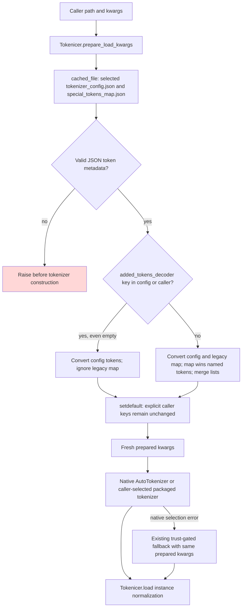

# Tokenizer preload metadata

`Tokenicer.prepare_load_kwargs(path, **kwargs)` returns a fresh dictionary for a
native or package-owned tokenizer's `from_pretrained` call. Some legacy bundles
serialize special tokens as dictionaries without the `__type: AddedToken`
marker. Transformers 5 can forward the list directly to the backend and fail
before Tokenicer can normalize an instance. The preparation step reads JSON
only and converts those entries to native `tokenizers.AddedToken` objects.



| Boundary | Before | After |
| --- | --- | --- |
| First native load, `Tokenicer._load_tokenizer` | Raw special-token list dictionaries reach backend | Metadata prepared before constructor |
| Retry, `Tokenicer._load_tokenizer` | Llama-only overrides applied after failure | Same prepared kwargs on first and fallback loads |
| `tokenizer_special_token_overrides` | Local-root Llama empty-string repair | Selected Hub/local JSON metadata and retained Llama repair |
| Explicit overrides | Retry could overwrite caller values | `setdefault` preserves keys, including `None` and empty lists |
| Named AddedToken flags | Config-first preparation loses historical legacy-map precedence | Without decoder metadata, map wins; with a decoder key, config wins |

## API and security boundaries

```python
prepared = Tokenicer.prepare_load_kwargs(
    checkpoint,
    revision=pinned_revision,
    subfolder="tokenizer",
    local_files_only=True,
    trust_remote_code=False,
)
native = PackagedTokenizer.from_pretrained(checkpoint, **prepared)
tokenizer = Tokenicer.load(native, model_config=selected_config)
```

The caller still chooses `PackagedTokenizer`; preparation never discovers a
class, invokes `AutoConfig`, imports checkpoint Python, constructs a tokenizer,
normalizes an instance, rewrites an asset, or maintains a custom metadata cache.
Unknown custom classes still fail closed in ordinary native Tokenicer loads.
Preparation preserves trust/config/model_config values; it does not grant trust
or filter a caller's security policy. Downstream loaders own that policy.

File selection passes `revision`, `subfolder`, `cache_dir`, `token`,
`local_files_only`, `force_download`, `proxies`, and `repo_type` to Transformers'
ordinary `cached_file` resolver. Missing optional metadata contributes no
overrides. Invalid JSON objects, token contents, or flag types fail immediately;
repairing the same local path is visible on the next call. Input assets remain
byte-identical. Llama's existing empty BOS/EOS/UNK compatibility remains, while
an explicit caller value, including `None`, takes precedence.

The metadata branch follows Transformers 4.45.2's `_from_pretrained` semantics:
the presence of `added_tokens_decoder` in config or caller kwargs (even `{}`)
suppresses the legacy map. Otherwise named map values replace config values,
and list tokens merge in config-then-map order. A `__type: AddedToken` marker
alone does **not** select the modern branch. Unlike historical truthiness-based
caller checks, preparation preserves every explicit caller key, including
`None` and empty lists. Non-string class metadata is left to the chosen provider
for contextual validation; preparation does not select or authorize classes.

## Reproduction and qualification

Source: `fnlp/moss-moon-003-sft` at
`3c06a7a241cef41caa9c339b149e9931d6b3deaa`. Its five tokenizer asset SHA256
values and six independent source-regex/byte/ranked-BPE ID cases are pinned in
`tests/test_prepare_load_kwargs.py`. Only JSON/text vocabulary assets are read;
no checkpoint Python or trained weights are loaded. The source-owned MOSS
constructor is GPT2-backed, and exact native GPT2 is the upstream consumer.
Its custom `MossTokenizer` class name is deliberately not authorized by this API.

Before the change, the real native constructor and a synthetic public
`Tokenicer.load` regression both raise
`TypeError: Input must be a List[Union[str, AddedToken]]`.
Prepared native construction, outer loaded-instance normalization, and serialized
reload preserve the independent source IDs, ordinary whitespace added tokens,
and SFT EOS `106068`. For example, `中文测试 Hello 12345` remains
`[54119, 52926, 18435, 17031, 2231]`.

The focused suite also covers native fallback, explicit `None`/empty-list
precedence, remote selection forwarding, real local subfolders with invalid
decoys, Llama compatibility, modern/legacy named flags, malformed metadata
repair, corrupt-vocabulary constructor failure and retry, and unchanged assets.
Tests compare against independent literal flags/IDs or explicitly constructed
native reference tokenizers, not the converter under test.

```bash
PYTHON_GIL=0 python -m pytest tests/test_prepare_load_kwargs.py -q
PYTHON_GIL=0 python -m pytest tests -q
```

Validation on Python 3.14.6t with `PYTHON_GIL=0`, Transformers 5.23.0 and CPU
Torch 2.15.0: focused suite **21 passed**; full suite **127 passed, 28 skipped**
in 22.38 seconds. The skips are 27 unavailable local tokenizer fixtures and one
pre-existing serialized-tokenizer fixture that no longer differs in this
Transformers version. Changed-path Ruff, compileall and `git diff --check` pass.

Follow-up qualification: **34 focused tests passed**; the complete committed
API family was **140 passed, 28 existing skips** in 23.30 seconds (excluding the
separate SP conversion suite). Four contradictory-metadata regressions failed
before the branch correction, with four modern-decoder controls passing.
The real pinned `baichuan-inc/Baichuan2-7B-Chat` assets at
`ea66ced17780ca3db39bc9f8aa601d8463db3da5` include conflicting EOS/UNK/PAD flags.
The native Rust BPE consumer must preserve source embedded-EOS IDs
`<s>hello</s><unk>` → `[1, 46955, 2, 0]`, including two backend serialization
cycles. The three asset SHA256 values are checked in the regression. No source
checkpoint Python is executed. The package-owned Baichuan consumer is qualified
separately downstream; native Llama by itself can mask the wrong EOS metadata
with existing special-token descriptors, so this regression clears those before
consuming the prepared objects.
Reinstating only the pre-fix helper makes that exact EOS assertion fail with
`[1, 46955, 2801, 92319, 92574, 0]` (one intended failure in 2.44 seconds).

Version `0.0.19` is an unreleased source candidate following merged
[Tokenicer PR #65](https://github.com/ModelCloud/Tokenicer/pull/65). Install a
verified Git commit until publication; no published dependency floor is claimed.
Native SentencePiece backend conversion semantics and source-specific BOS/EOS
serialization are separate from this metadata-only API.
