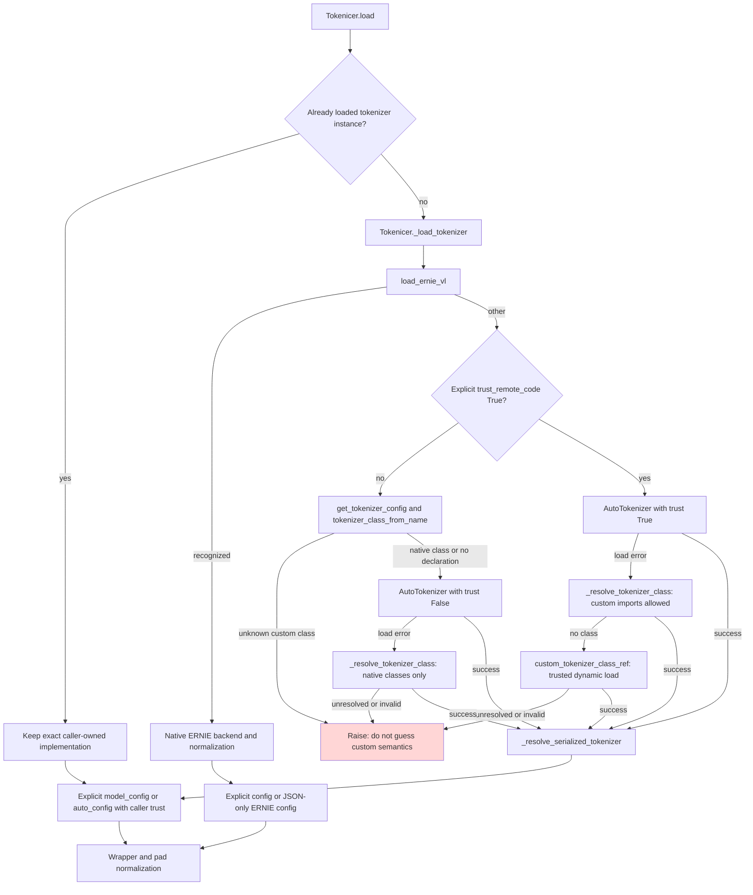

# Tokenizer trust policy

`Tokenicer.load` treats omitted trust, `False` and `None` as false. Only an
explicit `trust_remote_code=True` permits checkpoint Python. This is Tokenicer's
policy; downstream GPT-QModel additionally requires its separate safety bypass
before permitting checkpoint code. No environment switch was added here.



## Before and after

Line references for the unsafe implementation are pinned to Tokenicer
`51559e1ffb60290622b1b6e9db1a6beaac04174a`; current symbols are in
`tokenicer/tokenicer.py`.

| Mechanism | Before | After |
|---|---|---|
| Unknown custom declaration | `_load_tokenizer:204` could accept a generic backend from AutoTokenizer | `_load_tokenizer` rejects unresolvable classes before Auto dispatch without trust |
| Dotted module/local source scan | `_resolve_tokenizer_class:475-503` imported checkpoint-selected code without a trust argument | Resolver accepts explicit trust; without it only installed native classes resolve |
| Custom AutoTokenizer map | `_load_tokenizer:235-248` dynamically imported the reference even with trust false | Dynamic fallback runs only with explicit trust true |
| Local fallback retry | `_load_tokenizer:259-274` changed false to true | Escalation removed; the original load failure propagates |
| Default/None | AutoTokenizer could prompt, then Tokenicer could retry trusted | Both are forwarded as false; no automatic trust prompt or escalation |
| Owned instances/native behavior | Existing native ERNIE and serialized preference logic | Retained, including serialized preference opt-out and explicit trusted custom classes |

A valid `tokenizer.json` does not prove that an unknown class has no additional
normalization. In particular, scientific tokenizers require their exact owned
implementation. Supply an already loaded instance or explicitly authorize the
checkpoint class; the library does not silently substitute a generic backend.
An otherwise usable native tokenizer still has the metadata/config compatibility
fallback after AutoTokenizer fails. Explicit file-selection kwargs are forwarded
to the JSON trust preflight as well as the primary load.

## Executable evidence

`tests/test_trust_remote_code.py` builds tiny local WordLevel assets and inspected
checkpoint modules that write a marker. It uses the public `Tokenicer.load`,
not a mock of AutoTokenizer or the dynamic importer. It covers dictionary and
legacy-list maps with/without a class declaration, local `tokenization_*.py`
scanning, dotted imports and unknown custom declarations. False, None and omitted
trust all fail closed; replacing the same bundle's metadata with a native class
allows a successful retry with exact IDs `[4, 5]` for `hello world` and unchanged
PAD ID `1`. Explicit trusted custom loading, native fallback despite broken model
JSON, and direct tokenizer identity are positive controls. Two additional resolver
tests enforce the same boundary independently of the metadata preflight.

Against the pinned pre-fix worktree, these tests produce **23 failures, 6 passes**:
20 failures detect real marker writes (18 public-consumer cases and two resolver
cases); three detect silent generic substitution for an unknown custom class.
With the fix, the full repository suite on Python 3.14t / Transformers 5.23 is:

```bash
PYTHON_GIL=0 OMP_NUM_THREADS=1 python -s -m pytest -q tests --tb=short
# 61 passed, 28 skipped
```

The skipped tests are 27 unavailable private model fixtures and one legacy
AutoTokenizer case now handled natively. Existing real Llama tokenizer regression
tests continue to cover serialized preference and explicit opt-out. No trained
weights, network-hosted malicious code, GPU or older-Transformers qualification
is claimed. Version remains the unreleased `0.0.17` in the same release-bound PR.
